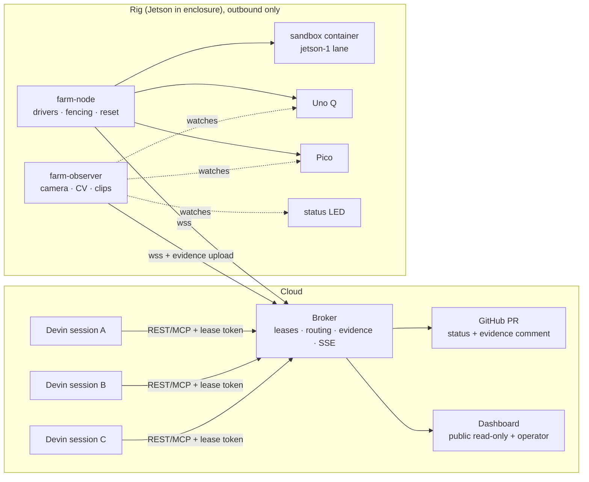

# Devin Farm: the concept, fleshed out

This is for the humans. The prompts in `prompts/` say *how* each direction builds. This file says *what we are building, why, what it looks like, and what came up during research that the prompts don't cover yet*. Read it alongside `RIG_DESIGN.md` (hardware rationale) and `docs/CONTRACTS.md` (interfaces).

Status tags: **[VERIFIED]** checked against primary docs on 2026-10-24 (links inline). **[VERIFY]** plausible but not checked; Agent 0 or the owner should confirm it. **[DECIDE]** the team needs to choose.

---

## 1. The idea in one paragraph

Coding agents now write firmware and embedded code, but they can't see what the hardware does, so they say "done" based on logs and hope. Farm is a **hardware lab on the internet that doesn't trust the agent**. A cloud Devin session (or any HTTPS client) leases one board, pushes code by git SHA, and gets back **evidence**: measurements taken by a camera and a benchmark harness that the agent can't touch, plus a video clip. The agent gets no shell on the rig. The verdict comes from the lab.

**Positioning:** the product isn't "Devin gets hardware access", because Outposts already does that. The product is **independent verification plus safe sharing**: a camera oracle, per-device leases with fencing and reset, evidence attached to the PR, and a trust boundary that holds even when the agent's code is hostile.

## 2. Who uses it, and for what

| Persona | Journey | What they see |
|---|---|---|
| **Devin session** (main user) | reads `describe` → acquires `pico-1` → pushes SHA → `observe` fails ("measured 1.1 Hz ± 0.07, expected 2.0") → fixes → passes → opens PR with the evidence link | REST/MCP JSON, evidence URL, key frames |
| **Engineer reviewing the PR** | opens the PR, watches the 3 s clip, reads the measured values, merges | GitHub comment + commit status + `evidence.json` page |
| **Judge / public viewer** | opens the public link, watches three boards light up live, sees one "claimed ✓ / confirmed ✗" moment | read-only dashboard, cropped camera |
| **Operator (us)** | checks rig health, drains leases, resets, deploys | admin endpoints, health strip, `rig/deploy.sh` |
| **Researcher (us, E1–E3)** | launches N sessions per arm, grades independently, plots | `experiments/` scripts and charts |

## 3. System at a glance



Core loop for a session: **describe → acquire → run → logs → observe → (iterate) → release → PR with evidence.**

## 4. Scope, tiered (what gets cut first is at the bottom)

| Tier | Item | Owner |
|---|---|---|
| **Must** | Broker leases + fencing + reset-on-expiry; REST API; evidence store | 1 |
| **Must** | Node: Uno Q + Pico drivers, idle programs, clean reset | 2 |
| **Must** | Observer: calibration, `led_blink`, `led_state`, `matrix_text`; clips | 3 |
| **Must** | 2 tickets + 2 trap variants; dashboard Farm Floor + assertions panel; replay mode | 4 |
| **Must** | E1 with `farm` vs `nofarm` arms; storyboard; backup replay | 4 |
| Should | Devin playbook (`SKILL.md`) registered via API; structured-output claim (§7.2) | 1 |
| Should | GitHub commit status + PR comment with clip | 1 |
| Should | `rgb_color`, `matrix_frame`; public read-only dashboard link | 3, 4 |
| Should | E1 `outpost` arm (now looks feasible via API, §7.1) | 1, 4 |
| Could | MCP wrapper; E2/E3 analyses; timeline Gantt | 1, 4 |
| **Cut first** | `jetson-1` sandbox lane + `jetson_bench` (rule from `RIG_DESIGN.md`: escape tests green by T+12 or it becomes a recorded segment) | 2, 3 |

## 5. UI: the dashboard

**Role:** it's both the demo and the operator console. Judges score design, and the dashboard is where they see it.

### 5.1 Screens

1. **Farm Floor** (default). The physical rig drawn to match the enclosure layout, so the camera tile and the card sit in the same place a viewer sees in the box.
2. **Session detail** (click a lease). Timeline of run → logs → observe calls, assertion history, transcript link, evidence clips.
3. **Evidence page** (`/e/<id>`, public, unguessable URL). The page a PR links to: clip, key frames, expected vs measured table, SHA, rig temperature. Must stand alone with no dashboard chrome and render well in a GitHub link preview (OpenGraph image = key frame with the verdict burned in).
4. **Experiments** (static). E1 claim-vs-confirmed chart, E2 duty cycle, method and sample sizes visible.
5. **Operator** (admin token only). Maintenance toggle, reset_all, lease table, deploy version per component.

### 5.2 Farm Floor wireframe

```
┌─ DEVIN FARM ── rig-1 ● LIVE ──────────── 41°C  load 1.8  mem 1.2G  cam ✓  node ✓  obs ✓ ─┐
│                                                                                          │
│  ┌ unoq-1 ─────────── LEASED ┐  ┌ pico-1 ──────────── LEASED ┐  ┌ jetson-1 ──── FREE ┐   │
│  │ [ live cropped matrix ]    │  │ [ live cropped LED ]       │  │ [ status LED ]      │   │
│  │ session  devin-7f3a        │  │ session  devin-2c91        │  │ queue  0            │   │
│  │ run      ● running  0:42   │  │ run      ● observing       │  │ last bench 34 fps   │   │
│  │ lease    3:12 left  tok 17 │  │ lease    4:01 left  tok 9  │  │                     │   │
│  └────────────────────────────┘  └────────────────────────────┘  └─────────────────────┘   │
│                                                                                          │
│  ┌ ASSERTIONS · pico-1 ────────────────────────────────────────────────────────────────┐ │
│  │ led_blink pico.led   expected 2.00 Hz ±10%   measured 1.10 Hz ±0.07   ✗ FAIL        │ │
│  │ ███ CLAIMED ✓ by session · CONFIRMED ✗ by camera ███                                 │ │
│  └─────────────────────────────────────────────────────────────────────────────────────┘ │
│  ┌ TIMELINE (30 min) ──────────────────────┐  ┌ EVIDENCE ─────────────────────────────┐   │
│  │ unoq  ▓▓▓░░▓▓▓▓▓░░░▓▓                   │  │ [clip] [clip] [clip]  →               │   │
│  │ pico  ░▓▓▓▓░░▓▓▓                        │  └───────────────────────────────────────┘   │
│  └─────────────────────────────────────────┘                                              │
└──────────────────────────────────────────────────────────────────────────────────────────┘
```

### 5.3 Visual design direction

- **Concept: "instrument panel / lab bench".** Dark, high contrast, readable when compressed in a 1080p video. The physical LEDs are blue (Uno Q matrix) and green/red (Pico, RGB), so the UI avoids saturated blue for chrome. That keeps the camera tiles the most vivid thing on screen.
- **Type:** a monospace face for every measured number (tabular figures, so values don't jitter as they update) and a condensed grotesk for labels. Numbers always carry units and `±` uncertainty, because that is the product's voice.
- **Colour semantics, used for nothing else:** green = confirmed by an instrument, red = contradicted by an instrument, amber = claimed but unverified / degraded rig, grey = offline. Never use green for "the session says it worked".
- **Signature element:** the **claimed vs confirmed banner**. Two columns, one for the agent's word and one for the camera's measurement. It's the hook shot in the storyboard, so give it most of the design effort.
- **Motion:** only state changes animate (lease acquired, verdict landed). A visible "VERIFYING…" scan line on the camera tile during an observe window, mirroring the observer's burned-in overlay.
- **Honesty affordances:** a permanent `REPLAY` / `MOCK` badge in replay mode, a "reconnecting" state instead of a blank screen, and a rig-health strip that turns amber with a reason ("throttled: bench results flagged").
- **Accessibility:** pass/fail never relies on colour alone (✓/✗ + word); contrast ≥ 4.5:1; respects `prefers-reduced-motion`.

### 5.4 Evidence artefacts (also UI)

- GIF < 3 MB for GitHub inline display; MP4 for the evidence page.
- Burned-in overlay: assertion, measured value, verdict, timestamp, "recorded by the Farm camera, not by the agent".
- Key frames as JPEG, so a session can *look* at them if Devin can view images by URL (Agent 0's V3 tests this).

## 6. Key design choices (and the reasons)

| Choice | Why | Alternative rejected |
|---|---|---|
| Agent has **no shell** on the rig | the oracle stays independent; one session can't brick the rig for others | Outpost-style shell (it becomes the E1 baseline arm instead) |
| Code arrives by **git SHA** | reproducible, auditable, the PR SHA = the verified SHA | upload tarballs (no provenance) |
| **Per-call leases**, 5 min TTL, 30 min cap | hardware use is bursty (E2 measures this); no permanent locks | session-held machine |
| **Fencing tokens** | stops a slow/zombie session overwriting a newer tenant | trust the lease id alone |
| Assertions are **data, not code** | the agent can't ship its own verifier | let agents submit test scripts |
| Every result has **measured ± uncertainty** | a pass without a number is not evidence | boolean pass/fail |
| **Cloud broker**, rig dials out | stable URL, graceful offline, no inbound ports at home | broker on the Jetson |
| **REST first**, MCP later | works for every harness; curl is debuggable | MCP-only |

## 7. Research findings that change or sharpen the plan

### 7.1 Outposts are closer than the prompts assume  **[VERIFIED]**
[Outposts overview](https://docs.devin.ai/cloud/outposts/overview.md): "N workers serve N concurrent sessions". Workers are outbound-only and run on any machine with the CLI. The [create-session API](https://docs.devin.ai/api-reference/v3/sessions/post-organizations-sessions.md) `platform` field accepts "the name of an outpost (BYOB) pool".
- **Pitch impact:** drop "one session per machine" as a contrast unless Agent 0 shows multiple workers on one host fail. Concurrency is not our differentiator (the prompts already say this), and now we have the evidence for it.
- **Experiment impact:** the `outpost` arm of E1 looks **feasible via the API** (`platform: "<outpost>"`). It's the most honest head-to-head available: same boards, shell access, no verification. Promote it from "only if feasible" to **Should**. Remaining check: linux_arm64 CLI on the Jetson's OS/glibc **[VERIFY]**.
- **Safety impact:** an Outpost worker on the rig gives that session root-equivalent reach to the camera and the observer. Run the `outpost` arm only in a dedicated experiment window, with the observer's results for that arm graded *after* the session ends from a fresh reset, and stop the worker afterwards.

### 7.2 Devin API features we should use  **[VERIFIED]**
The v3 create-session request accepts `session_secrets`, `secret_ids`, `structured_output_schema` (+ `structured_output_required`), `max_acu_limit`, `tags`, `playbook_id`, `knowledge_ids`, `attachment_urls`, `devin_mode`, `platform`.
- **`structured_output_schema` makes the E1 "claim" machine-readable.** Require `{claimed_success: bool, confidence: 0..1, evidence_url: string|null, final_sha: string}`. The grader then compares a typed claim against the camera instead of parsing chat. This removes the largest source of grading ambiguity.
- `session_secrets` for `FARM_API_KEY` (never in the prompt text). `max_acu_limit` per session as a hard cost cap. `tags` = `exp1/<arm>/<ticket>/<rep>` so runs are queryable later.
- Register `devin/SKILL.md` as a **playbook** and pass `playbook_id`. That keeps the workflow identical across sessions and makes it a measurable "use of Devin" feature.

### 7.3 USB is an attack surface the prompts miss  **[VERIFY, high priority]**
Agent code runs on devices that are **USB-attached to the trusted host**.
- **Pico:** recent MicroPython on RP2 can redefine its USB descriptors at runtime (`machine.USBDevice`, MicroPython ≥ 1.23) **[VERIFY]**. A hostile `main.py` could enumerate as a **HID keyboard** and type into the Jetson.
- **Uno Q:** its Linux side presents a USB gadget (ADB). If the agent's code gets root there, configfs could add HID/network functions **[VERIFY]**: does App Lab Python run as root, in a container, or as `arduino`?
- **Mitigations (Direction 2):** `usbguard` (or udev `authorized=0`) allowlisting exact VID:PID **and** interface classes per port; blacklist `usbhid`/`hid_generic` on the rig (we have no keyboard); if Uno Q uses ssh-over-USB networking, firewall `usb0` to the single port the node needs and bind the observer MJPEG to localhost. Add "Pico enumerates as HID" and "Uno Q opens new USB function" to `rig/tests/sandbox/` escape tests.

### 7.4 Reset must mean *clean*, not just "idle program running"  **[DECIDE]**
The next tenant inherits whatever the last tenant left behind:
- **Uno Q:** leftover daemons, cron entries, files in `~`, another app set as default. A lingering process could even fake LEDs during the next tenant's observe. Reset should stop all apps, kill the deploy user's processes, wipe `~/ArduinoApps/*` except idle, verify no default-app override, then start idle and **have the observer confirm the idle pattern before the lease is granted**. (Contract C2 already waits for a node ack; extend it to wait for camera-confirmed idle.)
- **Pico:** wipe the filesystem (`boot.py` as well as `main.py`) before copying idle.
- Proposed contract change: `reset` ack carries `idle_confirmed_by: "camera"|"node"`.

### 7.5 Contract inconsistencies spotted
- **ROI coordinates vs cropped stream:** C4 says the dashboard crops the MJPEG using ROI boxes normalised to the frame, while the observer prompt says the stream must never serve the full frame. → ROIs must be expressed **relative to the served (already-cropped) stream**. Direction 1 should fix this in C4.
- **Observe max 60 s vs bench duration:** a bench with warmup + 200 iters + quiet-mode handshake can exceed `duration_s` max 60. Either bench gets its own timeout, or `observe` returns 202 + poll for bench calls.
- **`log_contains` is agent-controlled:** fine as the naive baseline for traps, but the dashboard must never render it green ("confirmed"). Render it amber ("self-reported").
- **Status LED hardware:** C9 assumes a GPIO LED on the Jetson. Add it to the BOM (LED + resistor + 2 jumper wires) and confirm Jetson.GPIO on the actual JetPack.

### 7.6 Statistics: be modest  **[DECIDE]**
E1 at 3 reps × ~5 tickets × 2–3 arms = 30–45 sessions. A per-cell n of 3 cannot support percentages. Report **raw counts per ticket** and pooled rates with **Wilson 95 % intervals**, and pre-register that the traps are *designed* to elicit false claims (so the headline false-claim rate is "on adversarial tickets", not "in general").

### 7.7 Cost envelope
ACU per real session is unknown until Agent 0's V1/V9. Budget formula: `sessions × max_acu_limit`. Example: 45 E1 sessions × 3 ACU cap = 135 ACU worst case, plus ~10 for rehearsals. **[DECIDE]** the cap once V9 lands, and set `max_acu_limit` per session rather than relying on the launcher alone.

### 7.8 Demo timing reality
Uno Q first builds are slow (minutes), and a Devin session takes several minutes per iteration. A 3-minute video can't be one live take. **Live judging plan:** start the three sessions ~10 min before the slot, pin the dashboard, narrate the moment a verdict lands. **Video plan:** real footage, time-compressed with an on-screen clock so the compression is visible.

## 8. Hardware bill of materials (rig)

| Item | Note |
|---|---|
| Jetson (model TBD by Agent 0 R1) + barrel PSU | J48 jumper on original Nano |
| Powered USB 3 hub (switchable per port, or behind a smart plug) | Nano USB shares 1 A |
| Arduino Uno Q, Raspberry Pi Pico (+ header LED if onboard LED is hidden) | |
| USB webcam with manual exposure/WB (UVC), rigid mount | test `v4l2-ctl` controls before buying |
| Enclosure: matte black interior, diffused constant LED strip, white reference patch, corner fiducials | spec from Direction 3 |
| Status LED + 330 Ω resistor + jumpers for `jetson.led` | C9 |
| Ethernet cable, smart plug for hub power-cycle | C10 |

## 9. Risks not already in `RIG_DESIGN.md`

1. **USB-HID / gadget attack from agent code** (§7.3): could compromise the trusted host. Mitigate before any external session runs.
2. **Cross-tenant persistence** (§7.4): could fake a verdict for another session.
3. **Pitch over-claim vs Outposts** (§7.1): judges from Cognition will know the docs. Keep to verification + trust boundary.
4. **Grader ambiguity** in E1: fixed by structured output (§7.2).
5. **Camera privacy:** the stream comes from someone's home. Crop at the source (observer), not only in the UI.
6. **Single rig = single point of failure at demo time:** replay path + maintenance toggle (already planned); also pre-record each trap's camera clip.

## 10. Open questions for the team

1. **[DECIDE]** Is the `outpost` arm in E1 now (it looks feasible), and who runs the Outpost worker during its window?
2. **[DECIDE]** Should reset require camera-confirmed idle before re-grant (§7.4)? It costs ~5 s per handover.
3. **[DECIDE]** Public read-only dashboard during the whole hackathon, or only at judging time? (Privacy versus a "live link" story.)
4. **[DECIDE]** ACU cap per session and total.
5. **[VERIFY]** Agent 0: App Lab Python privilege level on the Uno Q; MicroPython USB-device support on our Pico firmware; Devin CLI on the Jetson's glibc; multiple Outpost workers on one host.
6. **[DECIDE]** Name/brand: "Devin Farm" is clear for this hackathon. If it should outlive the event, choose a harness-neutral name.

## 11. Judging criteria → where we score

| Criterion | Our evidence |
|---|---|
| Technical complexity | fencing leases over a WebSocket rig, CV oracle with uncertainty, sandbox + escape tests, bench orchestration |
| Use of Devin | API-launched sessions, playbook, session secrets, structured-output claims, PRs with evidence, E1 vs Outpost baseline |
| Working demo | three live sessions on one rig; replay fallback clearly labelled |
| Design | control-room dashboard, claimed-vs-confirmed banner, standalone evidence page |
| Originality | an oracle the agent can't touch; a measured false-claim rate |
