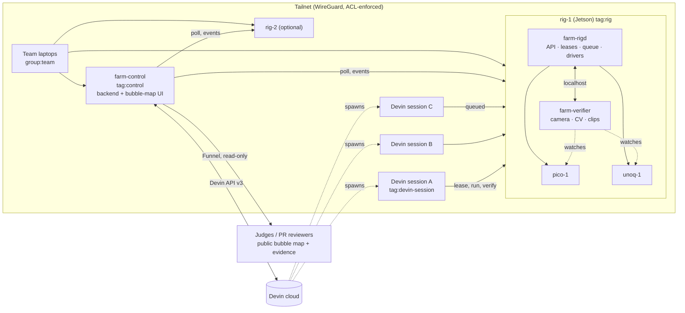

# Devin Farm: scope and requirements (v1, Tailscale design)

Supersedes the broker design in `prompts/` (v0.2) and `RIG_DESIGN.md`. Interfaces are in `docs/CONTRACTS.md` (v1.0-draft). Who builds what is in `docs/WORKSPLIT.md`. The bubble-map UI spec is in `docs/FRONTEND.md`. Hackathon deliverables and the live demo plan are in `docs/SUBMISSION.md`.

Tags: **[VERIFY]** = unconfirmed and must be checked on Day 0 (see §8). **[DECIDE]** = the team must choose.

## 1. What we are building

A hardware lab on a private network. **Rigs** (a Jetson with boards and a camera attached) join a Tailscale tailnet. **Cloud Devin sessions** join the same tailnet with short-lived identities, lease individual boards, deploy code by git SHA, and get back **camera-verified evidence** of what the board physically did. A **control plane** web app draws the whole system as a live bubble map. It lets a human poll hardware, watch session status, and prompt sessions.

The pitch: *"Any number of cloud agents, any number of real boards, one lock per board, and a camera that decides whether the code worked."*

## 2. What changed from v0.2

| v0.2 (prompts) | v1 (this doc) |
|---|---|
| Cloud broker holds leases; rig dials out over WebSocket | **No broker.** Each rig runs `farm-rigd`, which owns its own devices' leases and queue |
| Bearer API keys per session | **Tailnet identity.** The rig identifies callers by WireGuard peer (`tailscale whois`); each session joins with a one-off ephemeral key |
| Single rig | **N rigs**; each rig controls M devices; the control plane aggregates |
| Dashboard reads broker SSE | **Control plane** (`farm-control`) polls rigs, calls the Devin API, serves the bubble map, and can prompt sessions |
| Jetson GPU sandbox lane | **Out of v1** (stretch). The Jetson is the host only. This removes the riskiest security work |

## 3. Architecture

**Core session loop:** join tailnet → `GET /v1/devices` → lease (or queue) → run SHA → verify assertions → read measured results → iterate → release → PR with the public evidence link.

## 4. Components

| Component | Runs on | Job |
|---|---|---|
| `farm-rigd` | each rig | Tailnet-only HTTP API; per-device exclusive lease + FIFO queue + fencing; drivers (Pico, Uno Q); deploy by git SHA; reset to idle; health; event stream |
| `farm-verifier` | each rig | Camera capture, calibration, assertions (LED sequence, matrix image, blink, colour), evidence clips, **idle confirmation before the next lease is granted** |
| `farm-control` | its own tailnet node (default) or on rig-1 | Aggregates every rig into one graph; Devin API client (create, poll, message, archive sessions); mints session join keys; publishes evidence; serves the operator UI (tailnet-only) and the public read-only UI (Funnel) |
| `web/` | browser | Bubble map, side panels, prompt box, evidence viewer, replay mode |
| `session-kit/` | inside each Devin VM | `farm-join.sh` (join tailnet in userspace mode), `farm` CLI (curl wrapper), playbook/`SKILL.md` |

## 5. Requirements

### 5.1 Functional

| ID | Requirement | Tier |
|---|---|---|
| F1 | A rig exposes its devices, health and queues over the tailnet only; nothing is open on the public internet except control's Funnel | Must |
| F2 | **One lease per device.** A second requester for the same device is queued FIFO and sees its position; different devices on the same rig can be leased by different sessions at the same time | Must |
| F3 | Leases carry a monotonic **fencing token**; every lease-scoped call must present it and come from the holder's tailnet node | Must |
| F4 | Leases expire (TTL 300 s, renewed by activity, hard cap 1800 s). Releasing a lease, expiry, or the holder's tailnet node going offline triggers **reset → camera-confirmed idle → grant next** | Must |
| F5 | Deploy by `{repo_url, sha, path}`; the rig never runs agent code on the host, only on the target board | Must |
| F6 | Verifier assertions: `led_sequence` (Pico light patterns), `matrix_frame` (image on the Uno Q matrix), `led_blink`, `led_state`, `rgb_color`, `matrix_text`; every result is measured ± uncertainty | Must (first three), Should (rest) |
| F7 | Evidence (clip, key frames, results, SHA) at a public unguessable URL suitable for a PR | Must |
| F8 | One rig controls multiple boards; devices are declared in config, not hard-coded; adding a board = a config entry + a driver | Must |
| F9 | Multiple rigs appear in one control plane automatically (discovered by `tag:rig`) | Should (we may only have one physical rig; prove it with a second rigd in mock-driver mode) |
| F10 | **Bubble map**: nodes for sessions, rigs, devices and the camera; edges for physical attachment, camera coverage, active lease, and queue position; live updates ≤ 2 s | Must |
| F11 | **Poll hardware** from the UI: refresh health, take a cropped snapshot, show the last verdict | Must |
| F12 | **Session status** in the UI: Devin status, ACUs, current lease(s), last messages | Must |
| F13 | **Prompt sessions** from the UI: send a message to a live session; start a new session from a ticket with the join key injected | Must (message), Should (create) |
| F14 | Public read-only view through Funnel: the same map without prompt controls or transcripts | Should |
| F15 | Replay mode for the UI (labelled REPLAY), recorded from a real run | Must |
| F16 | Admin: maintenance mode (stop granting), revoke a lease, reset a device; team identity only | Must |
| F17 | GitHub PR comment with evidence summary + GIF | Should |
| F18 | Jetson GPU sandbox lane + benchmark | Stretch |

### 5.2 Non-functional

- **Security.** Tailnet ACL: sessions can reach only `tag:rig:8080`. Sessions can't reach each other, rig SSH, or control. Session join keys are one-off, ephemeral, pre-authorized, tagged and short-expiry. Prompting and session creation exist only on the tailnet-only operator port.
- **Cost.** Every created session has `max_acu_limit`. Control enforces a global ACU budget and refuses to create sessions past it.
- **Latency.** Lease grant on a free device < 1 s. A 10 s verify returns results < 15 s. The UI reflects state changes < 2 s.
- **Robustness.** rigd and verifier run under systemd with `Restart=always`. A service restart resets every device before granting. Locks and fencing tokens persist in SQLite.
- **Honesty.** No pass without a measurement. `log_contains` is self-reported and never shown as confirmed. Replays and mocks are always badged.
- **Privacy.** The camera stream is cropped to device ROIs at the source (verifier). The public view never shows the room.
- **Resource budget** (Jetson): verifier ≤ 1 core avg / 600 MB; rigd ≤ 10 % core / 150 MB; keep ≥ 1 GB free.

## 6. Out of scope (v1)

GPU sandbox lane; agents with shell access on the rig; non-Devin harness UX (the REST API works for them, but we don't polish it); auto-scaling rigs; user accounts beyond tailnet identity; analytics beyond the experiments.

## 7. Key decisions and trade-offs

| Decision | Why | Cost / risk |
|---|---|---|
| **Locks live on the rig** (no central broker) | The rig is the only thing that can safely reset its own boards; there's no cross-rig shared state to keep consistent; works with any number of rigs | No global queue across rigs. A session wanting "any free Pico" asks control for a suggestion, then leases from the chosen rig |
| **Identity = tailnet node** | No API keys to leak; ACLs enforce who can reach what at the network layer; a session's identity dies with its ephemeral node | Requires that a Devin VM can run `tailscaled` **[VERIFY, gating]** |
| **rigd binds the tailnet IP directly (plain HTTP on :8080)**, not `tailscale serve` | WireGuard already encrypts. Direct binding lets rigd run `whois` on the real peer address; behind `serve` it would see 127.0.0.1, and identity headers aren't set for tagged nodes | No TLS cert for the rig name; fine inside the tailnet |
| **One-off ephemeral join key per session**, minted by control via a Tailscale OAuth client (`auth_keys` scope) | Per-session identity (hostname `devin-<farm_id>`), auto-cleanup, revocable | Control must hold the OAuth secret; shared reusable keys are the fallback |
| **Control is a separate node** | The map survives a rig outage and shows it as offline; it is the natural home for the Devin API key and the public Funnel | One more process to host **[DECIDE]**: small VM (recommended) or rig-1 |
| **Poll-style verify** (`202` + `GET`, optional `?wait=25` long-poll) | Proxies in userspace mode and agent shells handle short requests better than 30–60 s blocking calls | Slightly more agent calls |
| **Evidence republished by control** on the public Funnel | PR reviewers aren't on the tailnet | Control stores copies; URLs must be unguessable |
| **Fallback if Devin VMs can't join the tailnet** | Expose rigd through control on Funnel with per-session bearer tokens; the same lease API, with identity = token | Weaker story, so it's documented rather than hidden |

Risks carried over from research:
- **USB attack surface.** A hostile Pico `main.py` might re-enumerate as a USB keyboard (MicroPython `machine.USBDevice` **[VERIFY]**). Mitigation: `usbguard` allowlist by VID:PID + interface class, blacklist `usbhid`.
- **Cross-tenant residue.** The Uno Q must have its apps stopped, user processes killed and app dir wiped; the Pico filesystem must be wiped. Idle must be camera-confirmed before the next grant.
- **Pitch vs Outposts.** Outposts already gives N concurrent sessions on your own machines ([docs](https://docs.devin.ai/cloud/outposts/overview.md)). Our difference is per-device locking and fencing across many sessions, no shell on the rig, and an independent camera verdict. Don't pitch concurrency or "hardware access" alone.

## 8. Day-0 checks (first 90 minutes, before contracts freeze)

| # | Check | Gate for | Owner |
|---|---|---|---|
| G1 | A Devin VM can install Tailscale and join with a pre-auth key: kernel mode with sudo, else `tailscaled --tun=userspace-networking --outbound-http-proxy-listen=localhost:1055` ([userspace docs](https://tailscale.com/docs/concepts/userspace-networking)) | **Whole design.** If it fails, switch to the §7 fallback | C |
| G2 | From that VM, `curl -x http://localhost:1055 http://rig-1:8080/v1/rig` works (MagicDNS through the proxy) | G1 | C + A |
| G3 | `session_secrets` on session create show up as env vars inside the session ([create-session API](https://docs.devin.ai/api-reference/v3/sessions/post-organizations-sessions.md)) | key delivery | C |
| G4 | A Tailscale OAuth client with `auth_keys` can mint a one-off, ephemeral, pre-authorized `tag:devin-session` key ([OAuth clients](https://tailscale.com/kb/1215/oauth-client)) | per-session identity | C |
| G5 | `tailscale whois --json <peer-ip>` on the rig returns the session's hostname/tags | caller identity | A |
| G6 | Jetson model/JetPack/Python; Uno Q transport (adb vs ssh-over-USB); Pico `mpremote`; camera FPS and exposure lock | rig plan | A + B |
| G7 | Pico firmware USB-device capability; Uno Q app privilege level | USB hardening | A |
| G8 | Devin can view an image by URL (evidence frames) | evidence UX | C |
| G9 | Funnel on the control node serves the public view ([Funnel limits](https://tailscale.com/kb/1223/funnel): ports 443/8443/10000, TLS only, bandwidth capped) | public demo | C |

## 9. Milestones

- **T+1.5** Day-0 checks done; tailnet up with ACLs; rig-1 reachable; contracts v1.0 frozen.
- **T+4** Every component runs standalone against mocks (mock rigd, mock verifier, mock Devin API, replay stream).
- **T+8** First real end-to-end: one Devin session on the tailnet leases `pico-1`, runs code, `led_sequence` verified, released, idle confirmed.
- **T+12** Two sessions on two devices at once, plus a third queued; bubble map live; prompting works.
- **T+16** Feature freeze. Experiments run; evidence on a PR.
- **T+21** Rehearsals ×2, backup replay recorded, video cut, submission drafted.
